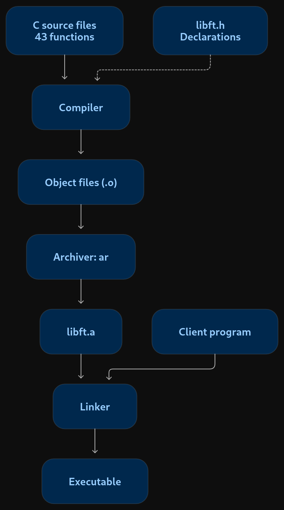

# Libft

**A small C library built from scratch — 42 / 1337 Cursus.**

Libft is the first library project in the 42 curriculum. It brings together 43 functions (34 mandatory and 9 bonus) in a reusable static library, `libft.a`. The project is about more than reimplementing utilities: it introduces memory ownership, pointer-based data structures, separate compilation, and linking.

**C** · **Static library** · **43 functions** · **Mandatory + bonus**

## Build

```sh
make             # build libft.a
make clean       # remove object files
make fclean      # remove objects and archive
make re          # rebuild from scratch
```

Requirements: a C compiler, `make`, and `ar`. The project builds with `-Wall -Wextra -Werror`.

## Use it in a program

```c
#include "libft.h"
#include <stdlib.h>

int main(void)
{
    char *message;

    message = ft_strjoin("Hello, ", "Libft!");
    if (!message)
        return (1);
    ft_putendl_fd(message, 1);
    free(message);
    return (0);
}
```

Save as `main.c`, then compile and run:

```sh
make
cc -Wall -Wextra -Werror -I. main.c ./libft.a -o demo
./demo
```

Functions returning newly allocated memory generally transfer ownership of that allocation to the caller: **free it when you are done**.

## How it fits together

<p align="center">
  
</p>

The **header** gives the compiler function declarations; the **archive** gives the linker compiled implementations. At link time, needed library code becomes part of the executable.

## Functions at a glance

| Family | Count | Examples |
|:--|--:|:--|
| Characters & case | 7 | `ft_isalpha`, `ft_isdigit`, `ft_toupper` |
| Memory & allocation | 7 | `ft_memset`, `ft_memmove`, `ft_memcmp`, `ft_calloc` |
| Strings | 14 | `ft_strlen`, `ft_strjoin`, `ft_split`, `ft_strmapi` |
| Number conversion | 2 | `ft_atoi`, `ft_itoa` |
| File descriptor output | 4 | `ft_putchar_fd`, `ft_putendl_fd` |
| Linked lists (bonus) | 9 | `ft_lstnew`, `ft_lstadd_back`, `ft_lstclear`, `ft_lstmap` |
| **Total** | **43** | **34 mandatory + 9 bonus** |

All function prototypes are in [`libft.h`](libft.h). Each implementation is in its corresponding `ft_*.c` file.

## Visual learning guide

**[Read the illustrated Libft guide (PDF)](docs/Libft_Visual_Guide.pdf)**

Written for students coming from the Piscine, the guide connects C libraries, pointers, stack and heap memory, compilation, string functions, dynamic allocation, linked lists, and Makefiles.

## Check the library

```sh
make fclean && make
ar t libft.a | wc -l   # expected: 43 with mandatory + bonus built
norminette ft_*.c libft.h   # if Norminette is installed
```

These are basic checks, not a complete test suite. Test edge cases and allocation failures separately.

---

**Houssam Alami** · 1337 / 42 Cursus
